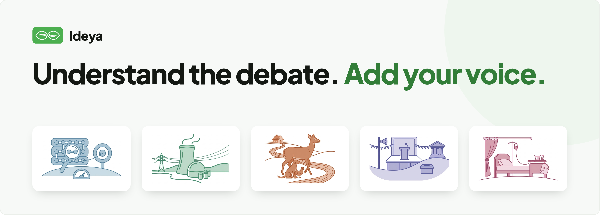
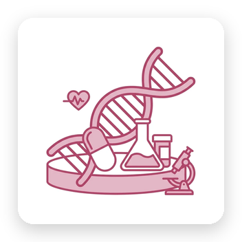
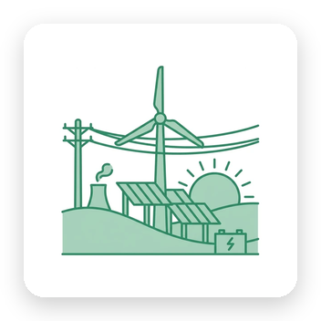
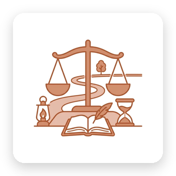
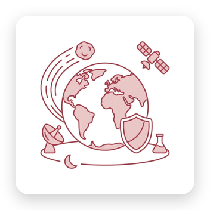
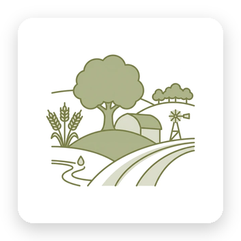
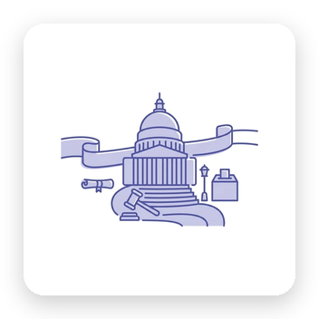
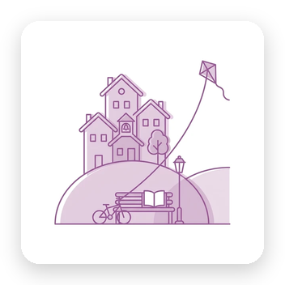

# Ideya

Ideya is a project I’ve thought about for years and only recently found a way to build. It’s a place where people can bring together what they know and what they believe, constructively, and where anyone can help work through the biggest problems we face.

I think that matters more now, for two reasons:

- **People feel unheard.** Many people no longer feel they can make a real difference. The institutions meant to listen to us and fix things, like government, political parties, universities, companies and the media, seem to be getting worse at both. And as AI takes on more of the work and knowledge that used to need people, everyday people’s ideas risk counting for even less.
- **A few people are shaping AI.** We’re building systems with more and more intelligence and power. The values, ethics and philosophy that shape them should come from more than a couple dozen people.

Ideya is my attempt to push back on both: a place where anyone’s knowledge and views get heard, weighed fairly and seen.

## How it works

Each topic gets one page, and you can engage as much or as little as you like. Everything opens at a glance, and every section can go deeper when you have the time.

Every page has the same six sections:

- **Overview:** what the topic is and why it matters now
- **Basics:** the key facts and numbers
- **Questions:** the open questions, split into ones evidence could settle and ones that come down to values
- **Positions:** each side’s case, at its strongest and in its own words
- **Crux:** the one question the disagreement really turns on
- **Actions:** ways to act on it, from learning more and backing a policy to donating, volunteering or getting involved locally

No sign-up needed: upvote what matters, say which way you lean on the open questions, and tell us what’s missing.

## Intellectual honesty

That’s our core editorial goal, and it means two things.

**Getting the facts right, and fixing them when we don’t.** We aim for accuracy but don’t claim perfection. Research takes time and page space is limited. What matters more is correcting errors as we or you find them. Like Wikipedia, we welcome readers pointing out mistakes.

**Every position at its strongest.** Where something is a matter of fact, we report the evidence. Where it’s a matter of values, we give each side its strongest reasonable case. If your view is stated poorly or missing, tell us. Mapping what people actually think and care about is the whole point.

## Topics

50 topics are live, with more coming soon: [ideya1.org](https://ideya1.org)

<table>
  <tr>
    <td align="center" width="20%"><a href="https://ideya1.org/category/ai/"> AI &amp; Machine Intelligence</a></td>
    <td align="center" width="20%"><a href="https://ideya1.org/category/bio-health/"> Bio, Health &amp; the Human Body</a></td>
    <td align="center" width="20%"><a href="https://ideya1.org/category/climate-energy/"> Climate &amp; Energy</a></td>
    <td align="center" width="20%"><a href="https://ideya1.org/category/digital/"> Digital Society &amp; Information</a></td>
    <td align="center" width="20%"><a href="https://ideya1.org/category/economy/"> Economy &amp; Work</a></td>
  </tr>
  <tr>
    <td align="center" width="20%"><a href="https://ideya1.org/category/ethics/"> Ethics &amp; Philosophy</a></td>
    <td align="center" width="20%"><a href="https://ideya1.org/category/global-risk/"> Existential &amp; Global Catastrophic Risk</a></td>
    <td align="center" width="20%"><a href="https://ideya1.org/category/food-land/"> Food, Land &amp; the Living World</a></td>
    <td align="center" width="20%"><a href="https://ideya1.org/category/governance/"> Governance &amp; Political Order</a></td>
    <td align="center" width="20%"><a href="https://ideya1.org/category/society/"> Society, Culture &amp; Identity</a></td>
  </tr>
</table>
