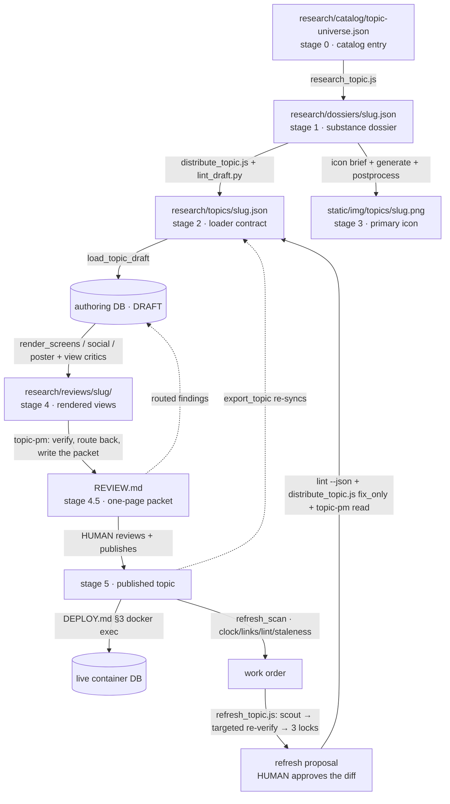

# The Ideya authoring engine — operator's manual

**This file is the single source of truth for operating the engine**: its structure,
order of operations, runbooks, routing, contracts, and failure modes. The rule that
keeps it true: **any commit that changes the engine updates this manual in the same
commit** — and `research/workflows/check_engine.py` verifies the machine-checkable
parts (inventory paths exist, the routing table matches the scripts' actual
constants), wired to run automatically after engine-file edits.

Which doc do I want?
- **Operate the engine** (run, resume, calibrate, debug) → this file.
- **Refresh a published topic** (the upkeep engine, on its own clock) →
  `research/REFRESH.md`.
- **Understand or change the design** (why the gates are shaped this way, decision
  history) → `research/RESEARCH_PIPELINE.md`.
- **The invariants** (publish rule, plain-text fields, fact locking…) →
  project `CLAUDE.md`. It is auto-loaded into every session and enforced by hooks;
  this manual references it rather than restating it.
- **Design system** (tokens, type, color discipline) → `design/`. **Icon spec** →
  `research/ICONOGRAPHY.md`.

The skills `/author-topic` and `/refresh-topic` are thin launchers into §5 (Runbook
A) and `research/REFRESH.md` — the procedure lives in one place, once.

---

## 1. What the engine is

The stages, by what each one owns (Jeff, 2026-08-28): **1 research** ·
**2 editorial** · **3 iconography** · **4 integration** · **4.5 the PM gate** ·
**5 the human**. The names are load-bearing — integration ASSEMBLES and verifies
that the pieces compose; it is not where editorial decisions get audited. When
stage 4 keeps finding the same class of content defect, the fix belongs in
stage 2, not in a better stage-4 critic.

A staged pipeline that turns a catalog entry into a publish-ready topic draft
(authoring), and keeps published topics accurate as the world moves (refresh). AI
drafts; a human publishes — always. Each stage writes a durable artifact and is
independently re-runnable; a stage that already has its artifact is skipped unless
redone deliberately.

Iron rules (enforced, not advisory — see `CLAUDE.md` Invariants for the full list):
- **Automation drafts; a human publishes.** `--status published` and
  `publish_topic` are both blocked from automation by
  `.claude/hooks/pipeline-guard.sh`.
- **The pipeline never edits templates or CSS** — code defects go in the review
  packet.
- **An unverified claim may not be asserted** — cut, soften, or attribute in-voice;
  never "please verify this".
- **Facts are locked after stage 1** — stage 2's patch whitelist rejects fact edits.
- Dev server on **8641, never 8642** (the live container; hook-blocked).

## 2. The map



## 3. Order of operations

| Stage | Engine piece | Does | Gate | Artifact |
|---|---|---|---|---|
| 0 Catalog | hand-authored entry + `load_universe` | register the topic stub + taxonomy edges | — | entry in `research/catalog/topic-universe.json` |
| 1 Research | `research/workflows/research_topic.js` | plan (+icon, prevalence_basis) → parallel section research (basics facts→shape + questions + one agent per position + actions) → crux → **claim ledger + isolated per-claim verification** → 3-critic substance gate + shape + ledger, every round → fix loop → verbatim prescribed-fix pass → **closing ledger pass on the final draft** | substance gate 5/5 (3 critics + ledger + shape), shape_notes empty, ledger closed **on the shipped draft** | `research/dossiers/<slug>.json` |
| 2 Editorial | `research/workflows/distribute_topic.js` + `lint_draft.py` + `budgets.py` | typography autofix → distill compact layer → **fold as a budget to spend**: reorder + tier + reveal → gate = 2 critics + **deterministic editorial check** + **claim fidelity** → whitelisted fix loop (1 round unless grounded) | gate pass + lint at 0 findings + loader loads with 0 warnings | `research/topics/<slug>.json` |
| 3 Iconography | brief agent + `research/icons/generate_icons.py` + `postprocess_icon.py` | brief → 4 Nano Banana candidates → pick vs checklist → normalize | checklist pass at 40px | `static/img/topics/<slug>.png` + `research/icons/<slug>.md` |
| 4 Integration | `render_screens/social/poster` + design-conformance critics | render every surface → conformance critique → content-fix loop (`fix_only`) | poster fit exit 0 + all 3 social formats + og card installed + no blocking content findings | `research/reviews/<slug>/` renders, cards, poster |
| 4.5 PM gate | `.claude/agents/topic-pm.md` | fresh-context read of the FINISHED topic: deterministic pass (lint/links/artifacts) → reads every render → routes findings to the owning stage → writes the packet | every deterministic check green + no open routed finding | `research/reviews/<slug>/REVIEW.md` |
| 5 Publish | **human** + `publish_topic` | read the packet → `publish_topic --confirm` (preflight → publish → reviewed_at) → commit → live push | human judgment | live topic |

Refresh (`refresh_scan` + `refresh_topic.js`) is the upkeep mirror, shaped around
three questions: **is there new information** (the scout), **what needs updating,
refining or deprecating** (the scan's work order → targeted re-verify), **is it
still accurate, fair and honest** (deterministic floor + one grounded critic +
the reader). Scoped, not exhaustive: a section nothing flagged is reported as
not-checked rather than re-verified. Three code locks make it structurally unable
to re-author a topic. `research/REFRESH.md`.

## 4. Parts inventory

<!-- inventory:begin — check_engine.py verifies each backticked path exists -->
| Piece | Role |
|---|---|
| `research/workflows/research_topic.js` | stage 1: substance research + claim ledger + substance gate |
| `research/workflows/distribute_topic.js` | stage 2: presentation distill/fold + gate; also `fix_only` view-feedback passes |
| `research/workflows/refresh_topic.js` | the upkeep engine: scout → targeted re-verify behind three locks → changelog + gate, stops at the human. Its manual is `research/REFRESH.md` |
| `research/workflows/budgets.py` | **single source of truth for content length**: db cap (loader slices) / hard bound (lint + stage 2's `presentationCheck` gate) / target (stage 2 writes to). Mirrored into stage 2's prompt AND its `BUDGET_LIMITS` table, guarded by `test_workflow_mirrors.py` |
| `research/workflows/lint_draft.py` | deterministic lint of a draft JSON; `--fix` applies safe rewrites |
| `research/workflows/seed_defects.py` | gate calibration: inject known defects, score detection |
| `research/workflows/tally_tokens.py` | per-run token/cost accounting |
| `research/workflows/check_engine.py` | verifies this manual against the code (routing + inventory) |
| `research/workflows/salvage_run.py` | rebuilds a stage-1 dossier from a run's `journal.jsonl` when the orchestrator never persisted it; `--scan` lists orphaned runs |
| `research/workflows/check_refresh_drift.py` | what the refresh engine has fallen behind on; `REFRESH.md` step 0, deliberately NOT in the authoring test path |
| `topics/tests/test_workflow_mirrors.py` | guard on the hand-mirrored workflow contracts (run after ANY workflow-script edit: `manage.py test topics.tests.test_workflow_mirrors`) |
| `topics/tests/test_refresh_guards.py` | guard on refresh's three locks; runs on refresh edits only, so authoring work does not carry it |
| `.claude/agents/claim-verifier.md` | stage-1 ledger verifier: `tools: WebFetch, WebSearch` only — the blindness is structural, not a prompt |
| `.claude/agents/topic-pm.md` | stage-4.5 PM gate: verifies the finished topic, routes findings, writes the packet. Fable (allowlisted), falls back to opus |
| `.claude/agents/icon-briefer.md` | stage-3 brief author; model pinned + verified by `check_engine.py` |
| `.claude/agents/view-critic.md` | stage-4 design-conformance critic; report-only, model pinned |
| `.claude/skills/author-topic/SKILL.md` | launcher for Runbook A (user-invoked only) |
| `.claude/skills/refresh-topic/SKILL.md` | launcher for `research/REFRESH.md` (user-invoked only) |
| `.claude/skills/participation-review/SKILL.md` | launcher for `research/PARTICIPATION.md` §5: per-topic reader-participation report whose proposal feeds a refresh as `args.findings` (user-invoked only) |
| `.claude/hooks/pipeline-guard.sh` | blocks automated publishing (`--status published` AND `publish_topic`) + dev-server-on-8642; heredoc bodies exempt so docs can quote the command |
| `.claude/hooks/engine-doc-guard.sh` | runs check_engine.py after engine-file edits |
| `topics/management/commands/load_topic_draft.py` | the loader: JSON → DB topic; wires catalog edges; idempotent |
| `topics/management/commands/load_universe.py` | catalog → DB stubs + taxonomy + all related edges |
| `topics/management/commands/publish_topic.py` | stage 5: preflight → publish → reviewed_at → prints the live-push commands. Human-only (hook-blocked) |
| `topics/management/commands/export_topic.py` | DB → canonical JSON re-sync; preserves top-level keys it cannot regenerate (`changelog`) |
| `topics/management/commands/check_links.py` | dead/placeholder/redirect audit (stat sources + action URLs + series rows); `collect_links()` is the public seam other commands reuse |
| `topics/management/commands/topics_due.py` | refresh queue by volatility cadence |
| `topics/management/commands/refresh_scan.py` | refresh step 1: clock + links + lint + staleness → the work order the whole run is scoped to (`--json` feeds it in) |
| `topics/management/commands/render_screens.py` | full-height page renders (1440/390/320, `--expanded`) |
| `topics/management/commands/render_social.py` | OG / square / portrait share cards |
| `topics/management/commands/render_poster.py` | print one-sheet; fit-check exit code is a hard gate |
| `research/icons/generate_icons.py` | Nano Banana candidate generation (`--edit` refines) |
| `research/icons/postprocess_icon.py` | winner → 1035×690 white-ground PNG + 40px thumb |
| `research/catalog/topic-universe.json` | stage 0: taxonomy + draft universe (edges' source of truth) |
| `research/dossiers/` | stage-1 substance records |
| `research/topics/` | canonical per-topic JSON (the loader contract) |
| `research/reviews/` | per-topic human review packets |
| `research/reviews/UI_DEFECTS.md` | standing site-wide UI-defect register (critics consult; human burns down) |
| `research/refresh/` | refresh proposals, packets, token records + pre-refresh snapshots |
| `research/icons/` | briefs, exemplars, candidates |
| `research/REFRESH.md` | the refresh engine's operator manual — separate from this one because the two run on different clocks |
| `research/PARTICIPATION.md` | the participation record's operator manual: what readers' actions write, the digest, when to read it |
| `topics/management/commands/participation_report.py` | Markdown digest of reader participation from the append-only `ParticipationEvent` log (`--topic`, `--since`, `--out`) |
| `topics/management/commands/seed_example_prompts.py` | seeds every topic's reader prompts (Add-your-view + the vote / lean / respond / missing follow-ups); the loader calls it each load |
| `research/RESEARCH_PIPELINE.md` | design rationale + decision history (the "why") |
| `research/ICONOGRAPHY.md` | icon visual spec |
| `design/` | locked design system (authoritative over any prompt) |
<!-- inventory:end -->

## 5. Runbook A — author a topic

One run = one topic through stages 0–4, then the stage-5 human hard stop. Run from
the repo root; always `.venv/bin/python`. Category slugs: `global-risk · ai ·
digital · climate-env · bio-health · economy · governance · society · ethics`.

> **Dual-use note.** Some catalog topics (engineered pathogens and similar) are
> blocked by content policy — stage-1 research agents error out. Author those via an
> external-research path onto the same `research/topics/<slug>.json` contract
> ("path B") and resume at stage 3.

### Stage 0 — catalog entry (only if not yet cataloged)

Author an entry in `research/catalog/topic-universe.json` matching the existing
shape: `{title, slug, summary, why_now, primary_category_slug,
secondary_category_slugs, suggested_icon, position_names, related_slugs}`.
`related_slugs` is this topic's **best 3–5 related topics, from its own
perspective** — the site shows **outgoing** edges only, and asymmetry is deliberate
(decided 2026-08-26): a niche topic may point at a hub without being one of the
hub's own best five, so never force reciprocity. When adding a new entry, also
review 1–2 neighboring entries and add this slug there only where it genuinely
belongs in *their* best 3–5. Then `manage.py load_universe` (idempotent) registers
the stub; it warns on any `related_slugs` entry that matches no topic (a renamed
slug once left a dangling reference that silently created no edge).

### Stage 1 — research (substance)

Pull the catalog entry and run `research_topic.js` via the Workflow tool with inline
args `{title, slug, summary, why_now, category, suggested_icon, positionNames,
questionsSeed:[], today:"YYYY-MM-DD"}` (map `primary_category_slug`→`category`,
`position_names`→`positionNames`). Stage-1 args are small — no baking needed.

**Persist the return the moment it arrives — before judging it.** The workflow's
agent results live in `journal.jsonl`, but the only path from there to
`research/dossiers/` runs through the orchestrator, so a session that ends
mid-run loses the topic even though every result is on disk. `wf_c56be1fa-390`
(2026-08-29, immigration-borders-restriction) spent **175.7M cache reads across
131 agents and left nothing**: no dossier, no topic JSON, a DB stub with zero
sections. It was the most expensive run in the corpus and it was invisible until
a token audit went looking. Write the file first, record the gate status in it,
assess after. A failed gate on disk is recoverable; nothing on disk is not.

**Before starting a topic, check for orphans:** `salvage_run.py --scan` lists
every stage-1 run and whether a dossier exists for it. An orphan is unfinished
work worth more than the next new topic. To recover one:
`salvage_run.py --run-dir <wf_dir> --slug <slug>` rebuilds the dossier from the
journal into `<slug>.salvaged.json`, marked `gate_status: "salvaged"`. It
recovers agent results verbatim but **cannot apply the fixer's patches** — the
journal stores patches, not the patched draft — so a salvaged draft needs its
gate re-run, which costs a fraction of re-researching. `resumeFromRunId` is the
in-session recovery path and is **same-session only**; once the session is gone,
the journal is the only route back.

Persist the return (`{draft, plan, verdicts, shape_notes, plan_positions,
claim_ledger}`) to `research/dossiers/<slug>.json` wrapped as `{dossier_version:1,
generated, slug, input, ...}`. Check: gate 3/3, `shape_notes` empty. Verdicts carry
`checks_run`; a check with `ran=false` fails its critic and re-runs once — a clean
gate means the checks actually happened.

**Basics is researched in two calls** — the facts (label/value/unit/note/detail/
tier/source_*), then the chart shape for those same facts (viz/wide/series/
range_*/fill_pct) — merged locally by exact label. A shape that arrives without
its data (ranked with no rows, range with no endpoints) is demoted to `bar` in
code, and an unmatched label defaults to `bar`; both are logged, never silent.
*Why:* one whole-section schema carrying both halves serialized to ~4.5KB and
the safety classifier refused it twice in `[basics]` on a large topic
("output schema too large to classify safely"). **Operating budget: keep any one
output schema under ~3KB.** Every schema in the engine now sits under that except
`refresh_topic.js`'s `reverify(BASICS_SCHEMA)` (~4.7KB) — the same trap, unsprung
so far because refresh edits an existing Basics rather than researching one.

The plan emits the Phosphor `icon` and, per position, `prevalence_weight` **with a
one-line `prevalence_basis`** (the evidence behind the weight — capture only, no
critic judges it yet; the dossier records it so the weight is checkable).

**The claim ledger** (between crux and gate): an extraction agent enumerates every
load-bearing claim — figures, dates, statute/EO names, "X did Y" — sweeping
position/question prose as hard as stats, because only stats carry `source_*` fields
and unsourced prose is where wrong claims hide behind a clean gate. Verifiers check
each claim in parallel seeing **only the claim + cited URL, never the draft** (a
draft primes rationalization). That blindness is **structural**: they run as the
custom `claim-verifier` agent (`.claude/agents/claim-verifier.md`), whose
`tools: WebFetch, WebSearch` frontmatter leaves them no way to open the draft or
the dossier — until 2026-08-27 they were general-purpose agents that inherited
`Read` and were merely *asked* not to look. A missing `source_quote` forces
`unverifiable` in code, and a claim that comes back with **no verdict at all** is
filed as blocking — an empty results array has no failures in it, so a
verification batch that died would otherwise report a clean ledger. `contradicted`/`unverifiable` are blocking; failing claims re-verify each fix
round **and are first checked against the revised draft**: a claim whose verbatim
`quote` no longer appears in the draft is marked `resolved-by-revision` in code
and stops blocking, because a claim the draft no longer asserts is not a live
defect. Without that, a landed fix kept scoring blocking for the rest of the run
(ai-alignment, 2026-08-27: 5 of 6 "blocking" ledger items were stale). Report
ledger coverage (supported/total, plus resolved-by-revision) in the packet — it
replaces asserting that facts were checked.

**Prescribed fixes are applied in code once the fix loop is spent.** A blocking
finding that quotes BOTH the target and its replacement ("replace “X” with “Y”")
is a repair the critic already wrote; after the loop, any such prescription whose
target still appears verbatim in the draft is applied as a literal string swap and
the finding is retired. Deliberately narrow — a fix that quotes only its
replacement leaves the target ambiguous and is left alone. Applied swaps are
recorded in the dossier's `prescribed_fixes` (no fixer agent authored them, so the
packet says so). *Why:* the loop is capped and judgment findings get one round,
so a prescription could expire unapplied and reach the human as a blocking defect
with its own fix printed beside it — democratic-backsliding, then ai-alignment.

**The ledger closes on the draft that SHIPS, not the one it was extracted from.**
After the fix loop and the prescribed-fix pass, a **closing pass** re-extracts on
the final draft, carries forward by atomic claim text every result that is still
`supported` (that verification stands and costs nothing to keep), and verifies
only what is new or rewritten — including content the fixer ADDED, which was
never swept before. If it finds blocking claims it gets one grounded repair
round, then re-verifies. *Why:* the ledger used to be extracted before the fix
loop and never re-run, so every sentence the loop rewrote left the run unverified
while still counting as coverage. Measured across the four topics carrying
ledgers: of 259 claims, only **129 were still asserted verbatim** in stage 1's
own final draft, and 25% of the ledger closed as `resolved-by-revision` (18 of 73
on vaccine-mandates, 22 of 70 on encryption) — which means the REPLACEMENT prose,
the sentence written to repair a wrong claim, was the least-checked text in the
topic. The packet reported that as "0 open".

**Every source scores every round.** The gate is critics + ledger + shape, rebuilt
from the current draft each round by `fullGate()`. Shape used to be computed once
and concatenated once, so after round 1 it vanished from the verdict set: its
blocking count went with it, and keep-best could select a draft that still
carried the defect. Because all three sources are always present, the verdict set
keeps a stable size and pass/block counts stay comparable across rounds.

**The fact-source critic owns the sourced stats, not the whole draft** (2026-09-02).
It is handed only `{overview, basics}` (its `view` in `CRITICS`) and told that prose
claims belong to the claim ledger. *Why:* it was sweeping position/question prose too,
which duplicated the ledger — measured on economic-inequality it cost **50.9M cache
reads against the ledger's 20.0M** for the entire per-claim sweep, because it re-read
the full draft on each of ~64 web turns. The ledger verifies prose claims **blind and
one at a time**, which is the stronger check; what only this critic can do is judge a
stat against its own cited source — attribution, vintage, precision, durability. The
Basics slice is ~27% of a draft, so its per-turn context drops by about three quarters.
It also now must verify any replacement figure it prescribes and name the source: a
prescription is applied verbatim once the loop is spent, so an unchecked replacement
ships as fact.

**Fact residuals are the pipeline's to close, never the human's.** Stage 1's
`applyPatch` has no field whitelist, so fact fields are fixable here. Re-run the
fact critic or apply its prescribed resolution (cut / soften / attribute in-voice).

**Stage 1 ranks; stage 2 folds.** `tier` is a RANKING — a new tier at each genuine
drop-off — and nothing else. `reveal` is no longer stage 1's to set at all: it is a
fold decision, three research agents were each assigning a display layer with no
knowledge of the display, and stage 2 reassigned it anyway. Two deterministic
rules keep the ranking usable: a section that comes back entirely one tier is a
blocking shape defect (an ungraded ranking tells stage 2 nothing), and stage 1 now
owns the geometry checks for every field stage 2's whitelist forbids it to touch —
`unit`, `label`, `source_label`, `source_published`, `lean_label_a/b`,
`proponents`, `representative_note`. Those were previously caught by lint after
both stages had finished, which left them with no owner.

**A seeded lean needs a named poll.** The questions call has no web tools (by
design — the search-agent distraction was making it miss its schema), yet it was
asked for `lean_pct_a` "grounded in real polling". It now returns `-1` unless a
real poll is in hand, names it in `lean_basis`, and a seeded percentage with an
empty basis is a blocking shape defect. `prevalence_basis` and any seeded lean are
also swept into the claim ledger as `inference` claims — both are numbers the
atlas publishes and neither had ever been checked.

**An orchestrator closure is not done until it is re-verified.** When the fix loop is
spent, remaining blocking findings are closed by applying the critic's prescription
directly (recorded in `prescribed_fixes` as `by: orchestrator-closure`). The script's
own closing ledger has already run by then, so **nothing in the engine checks that
text**. On economic-inequality, 2026-09-02, **three of three** prescribed replacement
facts spot-checked at this step did not verify — the Auten-Splinter magnitudes, CBO's
"top 0.01% grew more than sevenfold", and one finding quoting a superseded revision.
All three would have shipped as asserted fact.

So: every factual assertion a closure adds or rewrites must be verified before the
dossier is persisted, and the result appended to the ledger (see `d21b` on
economic-inequality for the shape). Dispatch the blind `claim-verifier` agent rather
than checking it yourself — the orchestrator marking its own homework is the exact
failure `claim-verifier`'s tool restriction exists to prevent. A closure that cannot
be verified follows the same three outcomes as any other claim: cut, soften, or
attribute in-voice.

> **This one is a rule, not a lock** — unlike the whitelist or the publish guard,
> nothing in code enforces it. The code version (a `close_only` entry point that
> re-runs `closeLedger` on a hand-closed draft) needs `closeLedger` to take its priors
> as parameters instead of closing over module state; worth doing when something else
> next opens that file.

**Nothing escalates mid-run (Jeff, 2026-08-27) — the engine decides editorial
forks itself**, by its own rules: a verified genuine missing camp is ADDED
(omission is a neutrality failure); when a critic offers alternatives, take its
primary prescription. Every such decision is flagged in the packet's "Check in 5
minutes" for the stage-5 human, who can override before publishing. The run never
stops to ask.

### Stage 2 — editorial (presentation)

**Stage 2 authors to the render geometry.** `research/workflows/budgets.py` is
the single source of truth for how long content may be, in three numbers per
field: the **db cap** (exceed it and the loader silently slices), the **hard
bound** (where the layout visibly breaks), and the **target** (what the design can
actually hold — stage 2 writes to this). Both bounds are now enforced inside stage
2 as well as by lint: `BUDGET_LIMITS` mirrors the same numbers in a form the
deterministic check can read, and the patch applier rejects an over-limit value
outright. The targets are also mirrored into the distill prompt as
`RENDER_BUDGETS`. All of it is guarded by `test_workflow_mirrors.py` — stage 2 was
handed these numbers in prose and no code ever compared its output to them.

Per-field budgets do not settle whole-sheet fit — that is a packing problem and
the poster's exit-code check stays — but meeting them is what keeps that check
quiet. (Why the budgets live in stage 2: `budgets.py`'s docstring and
`RESEARCH_PIPELINE.md` §3.)

Run `distribute_topic.js` with `{slug, title, today, dossier:<stage-1 return>}`.
**`dossier` must include `claim_ledger`** — stage 2 rewrites the prose stage 1
verified, and the fidelity check is what stops a rewrite from moving a claim. The
dossier is 60KB+ — bake it in via the `__ARGS` recipe (§10). Typography autofix →
distill → reorder + tier + reveal → gate → whitelisted fix loop.
**Display order = array order; `tier` marks the drop-off — move an item across the
fold by REORDERING. Positions are the exception: they render by `prevalence_weight`
(locked); steer their fold with `tier`.** Facts are whitelist-locked here.

**The fold is a budget to spend, not a threshold to clear.** Each section has room
for a set number of items above "Go deeper" (`budgets.FOLD`, mirrored from
`models.py`: basics 3/9, questions 3/6, positions 2/6). Measured across the 16
published topics, that room was going systematically unused: **Questions showed 4
of 7 on 14 of 16 topics** while the design had room for 6, and Basics showed 63%
of its stats against room for 9 (UBI showed 5 of 14). The fold was landing at the
first drop-off in the ranking rather than at the best cutoff the space affords, so
a third of the research sat behind a click and every page of the atlas broke in
the same place. The fold preview now states the capacity and the unused slots, and
a section that hides 3+ items while leaving slots empty is a blocking finding.
**The caps themselves are not the constraint and were left alone** — positions run
at 89% of capacity and the cap genuinely binds on big topics; it was the tier
grading that had collapsed.

**Stage 2's gate has three sources — four verdicts — scored every round**
(`fullGate`), matching stage 1:
1. **Two judgment critics** — compact-self-sufficiency (incl. above-fold
   selection) and reading-level fit.
2. **`presentationCheck`, the deterministic editorial check.** Budgets (hard
   limits, plus a gross 1.5x overrun of the target — targets stay guidance,
   because enforcing a "~" as a bound produced 357 corpus findings), plain-text
   invariants, editorial "we" scoped to the neutral voice, the two-register
   contract (a `detail` whose opening restates its compact line by bigram overlap
   adds nothing for the click it costs), paragraph structure, at least 3 condensed
   items per section, one condensed action per camp, order/tier agreement, and
   fold underfill. **It reports only what stage 2 can fix** — a deterministic
   finding on a whitelist-locked field is a finding the fixer can never close, and
   the loop would spend every round on it.
3. **`fidelityVerdict`, claim fidelity.** Stage 1 verifies against the world;
   stage 2 verifies against stage 1's record. For every `supported` claim whose
   verbatim sentence this stage rewrote, a **no-web** agent is given the stored
   `source_quote` and asked whether the new text still asserts what the source
   supports. Drift is blocking; a dropped claim is fine (nothing unsupported is
   being said); an unjudged claim is blocking, never a pass. *Why:* 31 verified
   claims across four topics were rewritten here with no re-check, every one of
   them previously `supported`.

Rounds are asymmetric here too now: **one round unless a grounded finding remains**
(`editorial-shape` or `claim-fidelity`). Until this stage had those, every finding
it had was judgment and it was spending three unanchored rounds on them — the
exact pattern `RESEARCH_PIPELINE.md` §6 exists to prevent, running in the stage
that writes the file that ships. Keep-best now breaks ties on blocking count, as
stage 1 has since the democratic-backsliding run.

Straight quotes, HTML entities and double spaces are **autofixed in code** on entry
and exit — the same rewrite `lint_draft.py` applies, moved to where the text is
written. They used to be fixed only after the workflow returned, so the critics and
the renders all saw the unfixed text.

Persist the return as `research/topics/<slug>.json` (`{draft, verdicts,
plan_positions}`; verdicts stage-tagged) **plus the dossier's `claim_ledger` as a
top-level key**. The loader ignores it and `export_topic` carries it forward, and it
is what lets a stage-4 `fix_only` pass run the fidelity check: those passes exist to
rewrite compact prose, which is exactly where a verified claim moves. Without it
stage 2 reports fidelity as not-run — never as a pass — and says so in the log.

**No `draft.categories` hand-step** — the
loader reads `secondary_category_slugs` off the catalog entry when the draft has no
`categories` key, and prints which source it used. That step was manual and its only
failure mode was silent: an audit on 2026-08-28 found two topics whose categories
disagreed with the catalog (`wildfires` missing `global-risk` and `economy`,
`housing-affordability-crisis` missing `society`), both drafts, both repaired.
`load_universe` cannot fix this — it skips any slug that already exists, by design,
so it never clobbers a topic. To re-audit:

```
manage.py shell -c "import json; from topics.models import Topic; \
cat={e['slug']:e for e in json.load(open('research/catalog/topic-universe.json'))['catalog']}; \
print([t.slug for t in Topic.objects.all() if (e:=cat.get(t.slug)) and \
{c.slug for c in t.categories.all()}!={e['primary_category_slug']}|set(e.get('secondary_category_slugs') or [])])"
```

Then, in order:
1. `lint_draft.py research/topics/<slug>.json --fix` — drive to **0 findings**.
   `--fix` closes the autofixable strings; for the judgment findings that remain
   (briticisms, weasel phrasing, loaded verbs, relative time — the register rules
   that need a call about proper nouns, and the single source for which is
   `lint_draft.py`), pipe them back through stage 2 rather than hand-editing:
   ```
   lint_draft.py research/topics/<slug>.json --json > <scratch>/lint.json
   # then re-run distribute_topic.js with args.fix_only = <that array>
   ```
   Hand-editing is the one repair path that leaves no record and passes no gate.
2. Load and confirm zero loader warnings:
   `manage.py load_topic_draft --file research/topics/<slug>.json --slug <slug>
   --title "<Title>" --category <cat> --status draft`
   (no `--image-brief` yet — the brief doesn't exist until stage 3 and the loader
   hard-errors on a missing path). Use the real slug for a new topic; use
   `<slug>-draft` only when a published version must stay online. The loader wires
   this slug's related-topic edges from the catalog automatically (idempotent, both
   directions).

### Stage 3 — iconography

Loop, capped at ~3 refine rounds (spec: `research/ICONOGRAPHY.md`):
1. The `icon-briefer` agent (Agent tool, `subagent_type: "icon-briefer"` —
   model pinned in its definition, verified by `check_engine.py`) writes
   `research/icons/<slug>.md` from the spec + `research/icons/categories.md` +
   existing briefs as exemplars (match their headings; the `## Generation
   prompt` blockquote is what the generator reads).
2. `python research/icons/generate_icons.py --slug <slug> --n 4` → candidates in
   `research/icons/candidates/<slug>/`.
3. **Read** the candidates; score against the checklist (uniform monoline stroke,
   same-hue ~16–18% duotone fill on EVERY major element — outline-only linework
   vanishes at 40px, category color, 2.5–3.5× scene complexity, white ground, no
   text/frame, 40px legibility). Judge family fit too: view the strongest
   candidate next to 2–3 existing winners in `static/img/topics/` — 38 tiles will
   sit on one wall, and per-icon quality does not guarantee the set reads as one
   hand. None pass → refine the prompt or `--edit <candidate> --edit-prompt
   "..."`. One passes → append a `## Selection` note to the brief.
4. `python research/icons/postprocess_icon.py --slug <slug> --src <winner.jpg>` →
   `static/img/topics/<slug>.png` (1035×690) + 40px thumb; Read the thumb to
   confirm legibility. Keep all candidates for human swaps.

### Stage 4 — integration (views)

Dev server up (`DJANGO_DEBUG=true … runserver 8641 --noreload`; **restart after any
template edit** — the compiled-template cache silently serves stale renders).
Render + critique, capped at ~3 rounds:
1. `render_screens --slug <slug> --base-url <dev>` plus an `--expanded` run
   (`?expanded=1` forces every Go-deeper extra visible — the depth layers get no
   coverage otherwise); then social in **two** calls, and
   `render_poster --slug <slug> --base-url <dev> --out research/reviews/<slug>`.
   `--base-url` is required on all three.

   ```
   render_social --slug <slug> --formats og      --base-url <dev>          # NO --out
   render_social --slug <slug> --formats sq,pt   --base-url <dev> --out research/reviews/<slug>
   ```

   **The `og` call takes no `--out` on purpose**: its default,
   `static/img/social/<slug>.png`, is the file `og:image` actually serves — a
   review-folder copy reaches no reader, and until 2026-08-27 this runbook
   shipped every topic with the generic site image that way. `sq`/`pt` are for
   manual posting and belong in the packet. The 4.5 PM checks the installed file.
2. `view-critic` agents (Agent tool, `subagent_type: "view-critic"` — model
   pinned in the definition) **Read** every image **for design-system
   conformance only** — against `design/DESIGN_SYSTEM.md` +
   `design/RESPONSIVE.md`, with `research/reviews/UI_DEFECTS.md` in hand. That narrow scope is the point: it is
   the read that produced 18 of the register's 19 entries, and it is the one thing
   no other stage does. **Is this on-system?** — not "is this good", which is the
   stage-4.5 PM's job over the same images. Two unguided judgment passes over one
   set of renders is the loop `RESEARCH_PIPELINE.md` §6 caps at one round.

   - **code/CSS defect** → check the register first: matches an OPEN entry →
     cite it, don't re-report; matches a FIXED entry → report as a REGRESSION;
     genuinely new and site-wide → append to the register. Never edit
     templates/CSS.
   - **content-fixable** (a bad fold, poster overflow) → `distribute_topic.js`
     with `args.fix_only:[findings]` → **re-lint** → reload → re-render. Length
     overruns should be rare now: stage 2 authors to `budgets.py` and its patch
     applier rejects an over-limit value outright, so a `fix_only` pass cannot
     reintroduce one. If overlong copy still shows up here, that is a budgets
     failure to fix in stage 2 — not a stage-4 finding to keep catching.
3. Pass = poster fit exit 0 + all three social formats + **the og card installed at
   `static/img/social/<slug>.png`** + no blocking content findings.

Stage 4 does NOT write the review packet — that is stage 4.5's output. What
integration owns is narrow on purpose: **produce every surface, and verify the
pieces compose.** Per-field fit is stage 2's; "is it finished and coherent" is the
PM's; what is left here is whole-sheet packing (the poster's fixed height cannot
be settled by any per-field budget) and design conformance.

### Stage 4.5 — the PM gate

The last engine step before the human. Invoke `topic-pm` (Agent tool,
`subagent_type: "topic-pm"`) with the slug, the title, the counts, the stage
verdicts and the ledger coverage. **Give it nothing from the dossier** — it judges
the finished artifact, not the research.

It is the only agent in the engine that sees the topic whole. Every other critic
reads one slice; a defect that only shows up when the page, the cards and the
poster are read together has, until now, had no reader but you.

Three properties make it a gate rather than a second opinion (rationale:
`RESEARCH_PIPELINE.md` §3, stage 4.5): **fresh context** (it never watches the
run, and must never BE the orchestrator — marking one's own homework);
**grounded findings only** (a failed check, a missing artifact, truncation — not
"could be sharper"); **it routes, it does not repair**.

Its deterministic pass is the checklist in the agent definition — lint at 0, links
0/0, the icon at 1035×690, **the OG card present at `static/img/social/<slug>.png`**
(not the review-folder copy), all three social formats, the poster, and all six
renders. Anything failing there is decidable and must never reach you.

Re-run the routed stages, then re-run the PM. Exit: every deterministic check
green and no open routed finding. It returns **CHECKS** (a fixed seven-line
PASS/FAIL block with the real numbers — the same "an unperformed check is not a
pass" rule the gate critics follow, in a shape you can read at a glance), then
ROUTING, then the packet markdown; the orchestrator writes
`research/reviews/<slug>/REVIEW.md` (§12) — the PM has no Write tool, so the
artifact stays under the orchestrator's hand.

**The PM repairs nothing, not even `lint --fix`.** It reads renders captured from
a loaded topic; editing the JSON underneath them desynchronizes the two, and the
packet would then describe a page that no longer matches its source. Autofixable
lint is a routed finding: fix, re-load, re-render, re-run the gate.

> **Honest limit:** the PM's blindness to the dossier is a prompt rule, not a tool
> restriction — it needs Bash for the deterministic pass, and Bash can read
> anything. Unlike `claim-verifier`, this one is convention.

### Account the run (with the PM gate's exit — every run, no exceptions)

**Every authoring run records its token spend** (Jeff, 2026-08-28) — tracking,
not optimization. When the PM gate exits clean, write the record beside the
packet, from the run IDs the orchestrator already holds:

```
.venv/bin/python research/workflows/tally_tokens.py \
  stage1=wf_<id> stage2=wf_<id> stage2fix=wf_<id> \
  icon=<agent-*.jsonl> views=<agent-*.jsonl> pm=<agent-*.jsonl> \
  > research/reviews/<slug>/tokens.md
```

Then prepend two header lines (run date + which IDs) and append one line for
stage-3 image generation (candidates × rounds — a Gemini call no Anthropic tally
sees). **Label stages 3, 4 and 4.5 separately** (Jeff, 2026-09-02): collapsing
them into one `agents=@<prefix>` line hid the single most variable non-stage-1
cost, and answering "where did the money go" meant reconstructing the split from
raw transcripts. Name each run's ad-hoc agents with a common slug prefix anyway,
so they are findable. **Token counts only, no dollar values** (Jeff, 2026-08-28): prices move
and recomputing from counts is trivial; a stale dollar figure in a committed
record reads as authoritative long after the rate sheet changed. Bare `wf_*` IDs are searched for under
this project's session dirs; `@query` matches named agents by
agentType/name/description, all matches summed — so name a run's ad-hoc agents
with a common slug prefix. Exemplar: `research/reviews/vaccine-mandates/tokens.md`.
The file commits with the packet (the `publish_topic` git-add block already
covers the directory).

### Stage 5 — human review & publish (the hard stop)

Read the packet, open the page, decide. Then:

```
manage.py publish_topic --slug <slug> --dry-run     # preflight + the plan
manage.py publish_topic --slug <slug> --confirm     # do it
```

`publish_topic` runs the whole local half: preflight (icon brief, primary art,
**the OG card at `static/img/social/<slug>.png`**, links 0 dead / 0 placeholder)
→ publish → `reviewed_at` → `rebuild_search` → print the live-push commands. It
refuses to write anything without `--confirm`, and a failed preflight aborts
before the publish rather than after it.

**Links are checked BEFORE the publish, not after.** The old order checked them
afterwards, which finds a dead link on a topic that is already live.

Then commit the artifacts and push to live — the live DB is separate; follow
"Publish one topic to the live site" in `DEPLOY.md` §3 (a `docker exec` load
against the live container — never copy the whole DB over it). `publish_topic`
prints those commands filled in, including a `curl` to confirm the topic actually
appears on the live site: a just-published topic missing from live is a known
failure mode (§11), and nothing used to check for it.

**This is still the hard stop.** The guard blocks `publish_topic` by name and
`load_topic_draft --status published`. Limits: it is not a sandbox
(`manage.py shell` can write `status` directly), it errs toward blocking a
quoted invocation, and heredoc bodies are exempt so docs can print the command.
(Why one command doesn't weaken the rule: `RESEARCH_PIPELINE.md` §3, stage 5.)

`--title` and `--category` are optional everywhere now: the loader takes the
title from the draft or the catalog entry, and the category from
`draft.primary_category`, then `draft.categories[0]`, then the catalog. It prints
what it resolved and errors when nothing supplies it — hand-typing them across
three near-identical invocations was the most likely thing to get wrong.

## 6. Runbook B — refresh a topic

**Moved to `research/REFRESH.md`.** Refresh runs a few times a year while this
engine is under weekly development; keeping its runbook in this file meant
authoring edits and a frozen upkeep system sharing a document. They are now
apart, and `research/workflows/check_refresh_drift.py` is what keeps the split
honest — it reports what refresh has fallen behind on and gates the refresh run,
not the authoring work.

In one line: a refresh answers **is there new information** (a scout), **what
needs updating, refining or deprecating** (`refresh_scan`'s work order → a
targeted re-verify of only what it flags), and **is it still accurate, fair and
honest** (deterministic floor + one diff-scoped critic + `topic-pm` reading it
whole). Three code locks make it structurally unable to re-author a topic.
Automation opens a proposal; a human approves every content change.

## 6a. Runbook B2 — read the participation

**Lives in `research/PARTICIPATION.md`.** Every reader action (upvote, lean,
prompt answer — including undo, switch and edit) is an append-only
`ParticipationEvent` row with the item and prompt text copied in, so it
survives reloads. `manage.py participation_report [--topic] [--since] [--out]`
turns it into a per-item Markdown digest, and `/participation-review <slug>`
(`PARTICIPATION.md` §5) turns that into a saved report — what readers did,
light fact-checking of what they claimed, and a proposal in the
editor-findings shape a refresh takes as `args.findings`. Run it before a
stage-5 review or a refresh of that topic. It informs the human — it changes
nothing by itself.

## 7. Runbook C — resume & recover

- **A workflow died or was checkpointed mid-run:** relaunch with
  `Workflow({scriptPath, resumeFromRunId})` and the SAME args — the unchanged
  prefix of agent calls returns cached. Inspect `journal.jsonl` in the transcript
  dir before assuming a cached result is non-empty.
- **A gate critic reported a check it could not run** (search pool spent): re-run
  that critic alone in a fresh workflow invocation — a new run gets a fresh pool.
  Verification should lean on WebFetch of primary sources anyway (separate,
  uncapped pool); search is for discovery.
- **A stage already has its artifact:** it is skipped on re-run; redo deliberately
  by regenerating the artifact.
- **Renders look stale after a template edit:** restart the dev server; the
  compiled-template cache does not invalidate under `--noreload`.

## 8. Runbook D — calibrate the gate

Clean gates are self-reported; a run of them is equally consistent with "good
drafts" and "agreeable judges". Inject known defects and count what comes back:
```
.venv/bin/python research/workflows/seed_defects.py \
  --src research/topics/<clean-topic>.json --out <scratch>/seeded.json
# run stage 1's gate against the seeded draft, save verdicts, then:
.venv/bin/python research/workflows/seed_defects.py \
  --score <scratch>/seeded.manifest.json <verdicts.json>
```
Seed from a topic that lints at 0 so every finding is attributable. Injection
targets are disjoint; classes span easy (`fact-wrong-10x`, `dead-link` — expect
~100%) to discriminating (`source-misattributed`, `unsupported-precision`). A class
at 0% is a blind spot to close with a rule, not a prompt nudge. Last calibration
(2026-08): 7/7 detected, plus real defects the gate had previously passed.

## 9. Cost, models, budgets

Judgment on **opus**, web grunt on **sonnet**, never below sonnet (defaults are
baked in the scripts — an `args.models` override alone does NOT reliably reach a
script).

**Fable: barred from the workflow scripts, allowed for the PM gate** (Jeff,
2026-08-27). The rule is call count, not tier — Fable is for high-level,
low-call-count roles only (history: `RESEARCH_PIPELINE.md` §9). `topic-pm` is
the only allowlisted agent; `topics/tests/test_workflow_mirrors.py` enforces
both halves — no `?? "fable"` in the scripts, no un-allowlisted agent
definition naming Fable.

**Fable → opus fallback.** If Fable's weekly allowance is spent, re-invoke the PM
with `model: "opus"` and change nothing else: `topic-pm.md` declares
`model: fable`, and an explicit `model` on the Agent call overrides the
definition. The prompt is model-agnostic, so the fallback is a one-line retry, not
a reconfiguration — but it is a retry the orchestrator performs, not something the
platform does for you.

<!-- routing:begin — check_engine.py verifies this table against the scripts -->
| Script | Model defaults | Effort pins |
|---|---|---|
| `research_topic.js` | plan=opus research=sonnet crux=opus critique=opus fact=opus fix=opus | research=high critique=high fix=high |
| `distribute_topic.js` | distill=opus distribute=opus critique=opus fix=sonnet | distill=high critique=high fix=low |
| `refresh_topic.js` | research=sonnet scout=research distill=research critique=opus fact=opus crux=opus fix=opus | research=high critique=high fix=high |
<!-- routing:end -->

The table above covers the three workflow scripts. The **agent-driven stages have
model choices too**, and they used to live only in runbook prose where nothing
checked them:

<!-- agents:begin — check_engine.py verifies the `model:` frontmatter -->
| Stage | Agent | Model | Notes |
|---|---|---|---|
| 1 verify | `.claude/agents/claim-verifier.md` | (inherits) | the caller passes `RESEARCH_MODEL` (sonnet) explicitly, so routing stays in the script |
| 3 icon brief | `.claude/agents/icon-briefer.md` | opus | one judgment call per topic |
| 4 view critics | `.claude/agents/view-critic.md` | opus | design-conformance reads only |
| 4.5 PM gate | `.claude/agents/topic-pm.md` | fable | allowlisted (§9 Fable rule); falls back to opus on a one-line retry |
<!-- agents:end -->

**Image generation is a separate bill nobody tallies.** Stage 3 calls
`gemini-3-pro-image` (Nano Banana Pro) for 4 candidates per round, up to ~3
rounds. That spend appears in no Anthropic token ledger and no run total — it is
a Gemini API charge. If icon cost ever matters, it has to be measured at the
Gemini side; `tally_tokens.py` will never see it.

High-volume subtasks pin efforts instead of inheriting the session's (often max) —
the main overage lever. Judgment singletons (plan, crux, distribute) inherit.

- **Web-search pool**: `CLAUDE_CODE_MAX_WEB_SEARCHES_PER_SESSION` (default 200,
  raised to 1500 in `.claude/settings.json`), shared across the session and all
  subagents. WebFetch draws on a separate pool the search cap does not touch —
  verification leans on it; search is for discovery.
- **Accounting — every run, tracked**: the standing record is
  `research/reviews/<slug>/tokens.md`, written at the PM gate's exit (Runbook A)
  and committed with the packet; refreshes write
  `research/refresh/<slug>.tokens.<date>.md`. `token-ledger.local.md` is
  historical only — its rows predate the 2026-08-28 double-count fix and are
  ~2.3× inflated. `research/workflows/tally_tokens.py` does the work — **by stage
  and by phase**. `label=path` args name each stage in the output (a path may be
  a run dir or a single `agent-*.jsonl` — the PM's transcript sits next to
  unrelated agents, so its file is passed, not its directory); `--by-phase`
  breaks a workflow run down into plan/research/crux/verify/gate/fix per model,
  classified by the sibling `meta.json` agentType first, else by a verbatim
  prompt fragment (`SIGNATURES`, mirror-guarded — reword a prompt without
  updating it and the test fails rather than the phase silently filing under
  "other"). Post-run, one command answers "where did the tokens go":

  ```
  tally_tokens.py --by-phase <stage1-wf-dir>
  tally_tokens.py stage1=<wf> stage2=<wf> pm=<agent-….jsonl>
  ```

  First real measurement (ai-alignment stage 1): **the gate phase was ~85% of
  opus cache reads** (47.8M of 56.3M) — critics re-reading the full draft each
  round dominate the bill, not research and not the fix loop. That is where any
  future cost work should aim first.

  **What the 2026-08-28 changes cost.** Stage 1 gained a closing ledger pass: one
  extraction (sonnet, low effort) plus verifier batches for whatever is new or
  rewritten, and at most one repair round. It is bounded by design — results are
  carried forward by atomic claim text, so only genuinely changed claims are
  re-verified. Stage 2 gained one no-web fidelity call per gate round, and only
  when a verified claim's sentence actually changed. Both are cheap against the
  gate phase, and both replace an unpriced cost that was being paid elsewhere: a
  wrong claim reaching the human, or reaching a reader. Against that, the round
  caps now bite in stage 2 and refresh (three unanchored judgment rounds became
  one), which removes two full re-gates from the common case — the single most
  expensive thing either script did.
  **Older numbers in `token-ledger.local.md` are overstated ~2.3x** (measured
  range 1.84–2.69 across the 40 runs still on disk): the script summed every
  streamed usage row per message instead of the final one, double-counting the
  cache columns, which are most of the bill. Output was barely affected, so the
  error hid where nobody looked. Divide recorded figures accordingly, or re-tally. Reference points:
  fable-era topic ~285k opus-equivalent output; first opus+sonnet-only run ~553k
  (inflated by a resumed double-gate + largest topic yet). Priced from the local
  ledger, stage 1+2 runs land at **$37–77 per topic** (excludes the orchestrator
  session and the icon/view side-agents).
- **The PM gate costs ~$5 on Fable** — 37 requests, 2.27M cache reads, 239k cache
  writes, 134k peak context; ~$2.60 on opus. Roughly 7–10% of a stage-1+2 run.
  Measured 2026-08-27 on frontier-ai-regulation, an unfavorable sample: 9 positions
  and a 45,000px expanded mobile render that the agent tiled and then carried in
  context. Cost here is **turns × an image-heavy context**, not thinking — output
  tokens are negligible. **Jeff, 2026-08-27: this is fine, leave it.** The known
  levers, if that ever changes: run the deterministic pass in the orchestrator and
  pass results in as text (~11 of the 37 requests), and downsample tall renders
  instead of tiling them at full resolution.
- **HARD STOP**: the moment any usage signal shows 90% of weekly limits — cease all
  runs and report.

## 10. Contracts & shapes

**Stage-1 dossier** `research/dossiers/<slug>.json`:
```
{ "dossier_version": 1, "generated": "YYYY-MM-DD", "slug": "...",
  "input": { "title": "...", "category": "..." },
  "draft": { overview, basics, questions, positions, crux, actions },
  "plan": { ...planner output incl. icon + positions (prevalence_basis lives here) },
  "verdicts": [ {critic, pass, blocking, notes, checks_run} ],
  "shape_notes": [], "plan_positions": [...],
  "claim_ledger": { claims, results },
  "prescribed_fixes": [ {critic, from, to, fields} ] }
```
A ledger `result.status` is `supported` | `contradicted` | `unverifiable` |
`resolved-by-revision` (the fix loop removed the sentence the claim was extracted
from, so it is closed rather than checked). A claim that got **no** result at all
is filed as blocking, never passed. The ledger persisted here is the **closing**
one, extracted from the final draft — so `claims` describes the text that ships,
and the packet's supported/total is a statement about that text rather than about
an intermediate draft. Draft positions carry `prevalence_basis`, and questions
carry `lean_basis`; both are swept into the ledger as `inference` claims. Stage 1
no longer emits `reveal` on stats/questions/actions — stage 2 seeds it from the
ranking.
```
```
`draft` is substance-complete, presentation-provisional (stage 2 finalizes
tier/reveal).

**Stage-2 args**: `{slug, title, today, dossier:{draft, verdicts, plan_positions,
plan, claim_ledger}}`. `claim_ledger` is required for the fidelity check — without
it stage 2 reports the check as not-run (never as a pass) and logs that its
rewrites are unchecked for that run.

**Loader contract** `research/topics/<slug>.json`: `{draft, verdicts,
plan_positions}` (bare `draft` also works; refresh adds a top-level `changelog`).
`draft.categories` is optional: the loader falls back to the catalog entry's
`secondary_category_slugs`.
The loader stores verdicts opaquely on `Topic.research_dossier`; the additive
`stage:` tag is harmless everywhere. Per-item fields the loader actually maps:

```jsonc
{
  "draft": {
    "overview": { "summary", "scope_covered", "scope_excluded", "why_now" },
    "basics": {
      "intro": "lead-in copy",
      "stats": [{
        "label", "value",
        "unit",                                       // <= 24 chars, spelled out; leading space before word units; currency goes in value
        "viz": "bar|ranked|radial|range|sparkline",  // default bar
        "wide": true,                                 // ranked tiles span two columns
        "series": [{ "label", "value", "pct", "highlight", "source_label", "source_url" }],
        "range_min", "range_max", "range_at",         // range viz track + marker (0-100)
        "fill_pct",                                   // ONLY a true share of a whole the tile names; null otherwise
        "note",                                       // one tight sentence (visible layer)
        "detail",                                     // deeper analysis on tile expand
        "tier",                                       // 1 = leading; new tier at a natural drop-off
        "source_label", "source_url",
        "source_published",                           // when the data is from
        "source_accessed",                            // when you verified it (YYYY-MM-DD)
        "reveal": "condensed|normal|deep"
      }]
    },
    "questions": [{ "text", "kind": "empirical|value", "why", "detail",
      "lean_label_a", "lean_label_b", "lean_pct_a", "tier", "reveal" }],
    "positions": [{ "name", "steelman", "description", "detail", "tier",
      "proponents", "representative_name", "representative_note",
      "prevalence_weight", "spectrum_position" }],    // color auto-assigned by index
    "crux": { "lead", "lead_highlight", "subtitle", "empirical", "values" },
    "actions": [{ "kind": "learn_more|donate|volunteer|policy|local|submit_view",
      "title", "description", "url", "for_position", "tier", "reveal" }]
  },
  "verdicts": [{ "pass": true, "issues": ["..."], "fixes": ["..."] }],
  "plan_positions": []
}
```
A rich viz arriving without its data falls back to `bar` with a warning. The loader
(re)seeds the 3 Add-your-view prompts plus the vote/lean follow-ups on every question and position, the respond-button prompts on every fact, question and position, and a Something-missing prompt on each Basics/Questions/Positions section each load, warns on placeholder action URLs
and truncated stat units/notes, and wires this slug's related-topic edges from the
catalog.

> **Shape caveat:** `nuclear-energy.gold.json` is in **export shape** — the content
> quality bar, not loadable. Loadable-shape example:
> `nuclear-energy-pipeline.json`.

**Presentation-patch whitelist (stage 2).** Edits allowed only on `{tier, reveal,
wide, note, why, steelman, description, detail, intro, lead, lead_highlight,
empirical, values, subtitle, summary}` — anything else
(value/unit/source_*/url/kind/name/text/label/proponents/representative_note/
lean_label_*) is rejected. **The whitelist also defines what stage 2 may be told
about**: its deterministic check reports only on these fields, because a finding
on a locked field can never be closed here. Those fields' geometry is stage 1's
(`shapeCheck`). `reorder`
takes a per-section full order of item ids (omitted items append). Stats/questions/
actions cross the fold by reorder; positions by `tier` (prevalence is locked).

**Fold reference** (must match `topics/models.py`): BASICS min/max 3/9 (3-col grid,
wide spans 2), QUESTIONS 3/6 (1-col), POSITIONS 2/6 (2-col). The workflows'
`foldPreview` reproduces `Section._tier_lead_count` exactly.

**Verdict contract:** each pipeline critic returns `{critic, pass, blocking, notes,
checks_run}`; `pass=false` only on a blocking defect ("parity with a strong
published topic, not perfection"); an unperformed check is filed as blocking, never
passed with a caveat. VERDICT_SCHEMA is hand-mirrored across the three scripts —
**change it in all three or the guard test fails** (`manage.py test
topics.tests.test_workflow_mirrors`; run it after any workflow-script edit). (The loader sample above shows
the older per-element `{pass, issues, fixes}` shape from manual refresh verdicts;
the loader stores either opaquely, so both round-trip.)

**The `__ARGS` recipe** (workflow scripts can't read files; 60KB+ args must be
baked into a run script):
```python
import json, re
dj = json.load(open("research/dossiers/<slug>.json"))
run_args = {"slug": "<slug>", "title": "<Title>", "today": "YYYY-MM-DD",
            "dossier": {"draft": dj["draft"], "verdicts": dj["verdicts"],
                        "plan_positions": dj["plan_positions"], "plan": dj["plan"],
                        # required: stage 2 rewrites the prose stage 1 verified
                        "claim_ledger": dj.get("claim_ledger", {})}}
body = open("research/workflows/distribute_topic.js").read()
runner = re.sub(r"\bargs\b", "__ARGS", body)                 # rewire the global
idx = runner.index("};\n") + 3                               # after meta
runner = runner[:idx] + "\nconst __ARGS = " + json.dumps(run_args) + ";\n" + runner[idx:]
open("<scratch>/run_distribute_<slug>.js", "w").write(runner)
```
Then `Workflow({scriptPath: "<scratch>/run_…js"})`. To syntax-check: strip the
leading `export` AND wrap the body in an **async** function (top-level `return`
won't parse bare; `export` won't parse inside a function; the scripts `await` at
top level, so a plain function won't parse either). For a view-feedback pass add
`"fix_only": [<findings>]` — skips distill/distribute, runs only the fix loop.

**Refresh args** (`refresh_topic.js`): `{current: {overview,basics,questions,
positions,crux,actions}, title, slug, category, today, scan, findings?}`. `scan`
is `manage.py refresh_scan --slug <slug> --json` verbatim — its `work_order` is
what the run scopes itself to, and every id on it (`w1`, `d3`, `editor`) is a
warrant an edit must cite in `because` or be dropped. Omitting `scan` leaves the
work order empty, so only the scout's developments can justify a change.

**Refresh proposal** `research/refresh/<slug>.refresh-proposal.<date>.json`:
`{draft, changelog, verdicts, unverified, not_flagged, developments,
scout_assessment, refused, shipped}`. `changelog` rows are **derived in code**
from what was actually applied, never self-reported by the agent that made the
change — the two used to be separate fields of one response and could disagree.
`change` is one of `updated | added | removed | link_fixed | verified_current |
reverted | refused | unverified`. The last three are the load-bearing ones:
`refused` and `reverted` are what the locks declined to do, `unverified` is a
section that had work and whose agent died. `not_flagged` names the sections
nothing flagged — scoped verification is only honest if what was skipped is
named. `shipped: false` means nothing survived, which is a normal result.

**Editorial rules** (the bar all content must meet; rationale in
`RESEARCH_PIPELINE.md` §8): neutral by intention; genuine steelman in each side's
own voice; honest non-balance (every genuine position, never forced 50/50, no
fringe-exclusion-by-omission); crux must narrow (no new facts, never "both sides
have a point"); every stat verified + sourced + dated (`source_published` +
`source_accessed`); recency pass on time-sensitive figures; durable by default
(isolate + date the perishable); source tiers (primary/peer-reviewed > journalism >
advocacy; the proponent is a position's source); depth = distill down (same
six-section skeleton at every depth; more room adds evidence, never sections).

## 11. Failure modes

| Symptom | Cause | Fix |
|---|---|---|
| Critic reports a check it couldn't run | shared search pool spent (the research fan-out runs first) | re-run that critic alone in a fresh workflow (fresh pool); lean on WebFetch |
| Render doesn't show your template edit | compiled-template cache + `--noreload` | restart the dev server — always, after any template edit |
| `args.models` override seems ignored | args don't reliably reach a script's `??` defaults | defaults are baked in the scripts; edit them there |
| Empty topic loaded, no error | fed an export-shape file (gold) to the loader | loader wants `{draft:{overview,…}}`; use a pipeline-emitted file |
| Poster stamp/fit silently wrong | render commands default to dead `localhost:8000` | `--base-url` is required on all three render commands |
| Fact errors surviving a clean 4/4 gate | wrong claims hide in unsourced position/question prose | the claim ledger exists for this; check its coverage number in the packet |
| A lint rule is on the books but the corpus still violates it | `lint_draft.py` runs at stage 2, so it only ever sees topics authored AFTER the rule landed | re-lint the corpus when a rule is added: `lint_draft.py --all`. Re-measured 2026-09-01, unchanged: **254 findings across 11 files** (4-33 each; nuclear-energy and its gold copy carry 33). Two of the 11 are not real topics — `nuclear-energy.gold.json` (export shape, the quality bar) and `nuclear-energy-pipeline.json` (the loadable-shape example). The six topics authored since the rules landed lint at 0, which is the check that the rules work. This debt is NOT refresh's to burn down (`REFRESH.md`, end) |
| Packet lists ledger defects the run already fixed | a failing claim was re-verified against its SOURCE each round but never against the REVISED draft | fixed 2026-08-27 — a claim whose verbatim quote is gone from the draft is `resolved-by-revision`; if stale items reappear, check that the fixer edited the quoted sentence rather than adding a second one |
| Workflow "could not be resumed" after session restart | background fork checkpoint | relaunch with `resumeFromRunId` + identical args; cached prefix returns |
| `render_screens` dies "within 200px of the capture window" | the page is taller than the capture height (long topics at 320px — expanded, or now unexpanded too: a 9-position / 10-action topic runs 12,349px unexpanded) | raise `CAPTURE_HEIGHT` or `CAPTURE_HEIGHT_EXPANDED` in `render_screens.py` (12,000→20,000 and 60,000 as of 2026-09-04) and re-capture — the hard error exists because a clipped capture handed to the view critics reads as a complete render (ai-alignment, 2026-08-27) |
| Stage-1 agents error out on a topic | dual-use content policy | path B: external research onto the loader contract, resume at stage 3 |
| `output schema too large to classify safely` | an output schema over ~3KB (worst with a long prompt) | split the call and merge locally, or move rich sub-objects to JSON-encoded strings (what stage 2's `add_*` does); stage 1's basics is split facts→shape for this reason |
| `agent type '<name>' not found` mid-run | the custom-agent registry picks up a new `.claude/agents/*.md` on a **lag**, not instantly | wait and retry before doing anything drastic — 2026-08-27: a just-written definition failed to resolve, and the same file resolved later in the same session with its tool restriction intact. Restarting the session also works but is rarely needed |
| Link previews show the generic Ideya mark | the og card was rendered into the review folder, not `static/img/social/` | stage 4 runs the `og` format with NO `--out`; the review-folder copy is not what `og:image` serves |
| `reviewed_at` never set, topic re-queues early | it was a separate `shell -c` after the publish, easy to forget and silent when missed | `--reviewed` on the loader (or `publish_topic`, which passes it) stamps it in the same transaction |
| Live site missing a just-published topic | authoring DB ≠ live DB | `DEPLOY.md` §3 docker-exec load; never copy the whole DB |
| Packet reports a clean ledger but the prose was rewritten after verification | the ledger was extracted pre-fix-loop and never re-run | fixed 2026-08-28 — stage 1's closing pass re-extracts on the final draft, stage 2's fidelity check catches rewrites there. If it reappears, check that `claim_ledger` is actually reaching stage 2's args |
| A deterministic defect disappears from the gate after fix round 1 | the verdict was computed once and concatenated once, so the re-gate dropped it | both stages rebuild every verdict source each round via `fullGate()`; guarded by `test_deterministic_findings_are_gate_input_every_round` |
| Stage 2's fix loop spins on a finding it can never close | a deterministic finding named a field the presentation whitelist rejects | the check is scoped to `PRES_FIELDS`; a geometry defect on a locked field belongs to stage 1's `shapeCheck` |
| The same sections fold in the same place on every topic | tier 1 came back a habitual size, so the fold landed at the first drop-off rather than filling the space | the underfill check + the capacity line in the fold preview; stage 1's flat-ranking shape rule. Caps in `models.py` are NOT the constraint — positions run at 89% of theirs |
| A topic is missing from a category page it belongs on | `draft.categories` was a hand-step and forgetting it is silent | fixed 2026-08-28 — the loader falls back to the catalog's `secondary_category_slugs`. **Verified against the DB 2026-09-01: all three published topics carry the edges the catalog specifies.** A missing `draft.categories` in the JSON is not evidence of a missing edge — the fallback covers it — so check `Topic.categories` before concluding anything from the file |
| Two substance verdicts on file have their whole report in the `critic` field and no name | the critic returned its prose in `critic` (the schema's free-text slot) and the writer keyed by index, so the stored record is identifiable only by content — a later `fix_only` or tooling pass that looks verdicts up by name will not find them | **open** (social-media-youth-mental-health, 2026-09-04, found by the 4.5 PM). Same family as the per-critic overwrite row above: the verdict record needs a stable `key` written by the script, not the model, on every entry. Fix with the verdicts-per-round change |
| A topic's stored `verdicts` show a critic FAILING that actually passed | the array holds **one record per critic**, so a later `fix_only` re-gate overwrites the main gate's record. A pass followed by a disproved or since-closed failure ends up on file as the failure, and a cold reader of `research/topics/<slug>.json` sees only the FAIL | **open** (economic-inequality, 2026-09-02: main-gate `claim-fidelity` PASS was overwritten by a `fix_only` FAIL that was then disproved and closed as ledger `d21b` = supported). Do **not** hand-edit the verdict to make it look right — it is a gate record. State the sequence in the packet's Run line, which is what the 4.5 PM did unprompted. A real fix means keeping verdicts per gate round rather than per critic |
| A view critic cites a mobile defect "by construction" instead of seeing it | the expanded mobile captures run 38,000-49,000px tall and reach an agent downsampled to roughly **13-77px wide** — unreadable. The `CAPTURE_HEIGHT_EXPANDED` guard stops a capture being silently *clipped*, but an unclipped render nobody can resolve is barely better | **open** (economic-inequality, 2026-09-02). We pay to render the tall captures and pay an opus critic to read them, and get no real mobile coverage; the critic named the limit rather than implying coverage it lacked, which is the behavior to keep. Shape of the fix, not yet built: per-section captures at the mobile breakpoints (one image per `.sec`) put each at a readable scale without changing what is rendered, and would make the <=360px ranked-row entry visible instead of inferable |
| `check_links` reports a live, correctly-cited source as **dead** | two separate causes, both false positives: (a) some hosts answer **HEAD with 404** on a page that GETs 200 — ourworldindata.org grapher pages do this; (b) a host that refuses scripted clients at the network level is only forgiven when it is `.gov` or listed in `_BOT_WALLED_HOSTS`, and that match is by **exact hostname**, not registrable domain | fixed 2026-09-02 (economic-inequality): 404 joined `_GET_FALLBACK_CODES` so a HEAD 404 is retried with GET, and `fred.stlouisfed.org` was listed explicitly. A false dead blocks the 4.5 gate and sends a human chasing a working link, so one wasted GET per genuinely-dead link is the cheaper trade. When adding a bot-walled host, list the **exact subdomain** |
| A source URL silently rots into a redirect | the publisher renames a slug and 301s; `check_links` reports it as `redirect` with the final URL, which is easy to skim past because it is a WARNING, not an error | repoint `source_url` at the reported final URL after confirming the target is the same data (OWID retired `income-share-top-1-before-tax-wid` → `incomes-of-the-richest?quantile=richest_1pct&welfare_type=before_tax`). `source_url` is stage-1-owned — stage 2's whitelist rejects it |

Refresh has its own failure-mode table in `research/REFRESH.md` — the two
systems run on different clocks and their symptoms do not overlap.

## 12. Appendix — REVIEW.md template

Written by the stage-4.5 PM, persisted by the orchestrator. **One page, hard.**
Links first — the point is one click to each view.

Nothing mechanical reaches this file. Facts, links, lint, missing artifacts and
truncation are closed inside the pipeline; if one shows up here, the gate leaked.
Engine-development narrative does not belong here either — that goes in
`RESEARCH_PIPELINE.md`. Packets drifted to 50–259 lines (mean ~94) by absorbing
calibration findings and engine notes, which is how a review packet becomes a
build log the human has to mine.

```
# <Title> — review packet (<date>)

**DRAFT `<slug>`** · <n> stats · <n> questions · <n> positions · <n> actions
Fold above "Go deeper": basics <n>/<N> · questions <n>/<N> · positions <n>/<N>

## Look
[page](http://localhost:8641/<slug>/) · [expanded](http://localhost:8641/<slug>/?expanded=1)
[1440](desktop-1440.png) · [390](mobile-390.png) · [320](mobile-320.png)
[OG](<slug>.png) · [square](<slug>-sq.png) · [portrait](<slug>-pt.png) · [poster](<slug>.pdf)
<the first two need the dev server up on 8641>

## Run
substance <n>/5 (critics + ledger + shape) · presentation <n>/4 (critics + editorial-shape + claim-fidelity)
ledger <supported>/<total> closed on the shipped draft · fidelity <n> rewritten claim(s) checked · lint 0 · links 0/0 · poster fits (<n>px)
Rounds: research <n> · distribute <n> · icon <n> · views <n> · PM <n> (<n> routed, all closed)

## Decided for you
<editorial forks the engine resolved by its own rules, one line each, naming the
 rule it applied. "None this run" is a valid and common answer.>

## Check in 5 minutes
<at most THREE, editorial only — a call you might make differently. Never a fact,
 never a mechanical defect. Empty is a good packet, not a suspicious one.>

## Engineering (the pipeline may not touch CSS)
<new site-wide defects, or "none — <n> open entries cited from UI_DEFECTS.md">

## Publish
manage.py publish_topic --slug <slug> --dry-run    # preflight + plan
manage.py publish_topic --slug <slug> --confirm    # publish + reviewed_at
→ it prints the commit and DEPLOY.md §3 live-push commands, filled in.
```
