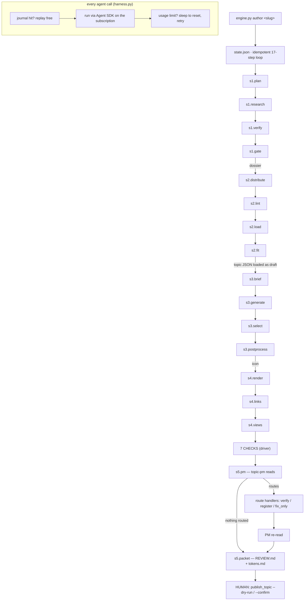

# The engine, end to end — what, how, why

From `engine.py author <slug>` to a loaded draft, its surfaces, and the packet. Read
top to bottom: this is the order things happen in. Every box below has a **What**
(the job), a **How** (the mechanism, with the file that does it), and a **Why** (the
failure it exists to prevent, usually one we paid for). Companion to `README.md`
(how to operate it) and `../ENGINE.md` (the stage contracts in depth).

---

## 0. The run itself

### `engine.py author <slug>`
- **What:** one command; input is a slug in `research/catalog/topic-universe.json`, output is a loaded DRAFT topic, every surface, and `research/reviews/<slug>/REVIEW.md`.
- **How:** `Run.run()` walks `STEPS` in order. Each step is a method; it records `running → done|failed` with a one-line note in `research/runs/<slug>/state.json`. Done steps are skipped on re-run; artifact guards make steps skip themselves when their output already exists.
- **Why:** the previous engine was three good agent scripts joined by ~60 hand steps per topic; the joints were where the hours and the defects went (a closure lost to a later rewrite, a runner baked before a URL fix). A state machine has no joints.

### The harness (`harness.py` + `bridge.mjs`), under every agent call
- **What:** runs the two stage scripts unchanged and serves each `agent()` call.
- **How:** `bridge.mjs` loads the script as one async function and supplies `agent/parallel/pipeline/phase/log/args`; each `agent()` becomes a JSON line to Python. The harness hashes (prompt, opts): a journal hit returns instantly; otherwise it launches headless Claude Code through the Claude Agent SDK with the model, effort, JSON schema, tool allow-list and system prompt the call needs, under a concurrency semaphore. A "session limit · resets 7pm" answer is parsed and slept through; other failures retry with backoff, then return `null` (the contract the scripts were written against).
- **Why:** the subscription is the budget, so the engine has to survive the limit it will hit once per run; a per-call journal makes the checkpoint finer than any stage. The scripts embody months of tuning; running them unchanged means no port risk.

### Tool policy (in the harness)
- **What:** who may reach what.
- **How:** by the script's `agentType`: `general-purpose` → WebSearch + WebFetch; `claim-verifier` and `camp-scout` → web only, with their `.claude/agents` body as system prompt; `topic-critic` → nothing; `view-critic`, `topic-pm`, `icon-briefer` → Read only; no agentType → nothing. MCP servers off.
- **Why:** a verifier that can open the draft is not independent; a critic with a browser re-verifies figures the ledger already checked at whole-draft prices (39M → 18M cache reads when the critics lost the web); Bash was ~150 wasted calls per topic.

---

## Stage 1 — research (substance). `research_topic.js`, four phases

Output: `research/dossiers/<slug>.json` — the topic's source of truth for facts. Everything here is written for substance, not length.

### s1.plan — the scope & spine planner
- **What:** lock scope covered/excluded, why-now, the questions, the positions with prevalence weights and their basis, a spectrum order, an icon hint.
- **How:** one opus agent with web search, high effort, structured `PLAN_SCHEMA`. The driver persists the returned `plan` into the dossier and stops (`stop_after: plan`).
- **Why:** research without a spine drifts into whatever the first sources say. Prevalence weights set here are how the page carries honest non-balance without a house verdict; `prevalence_basis` is recorded so the ledger can later verify it like any claim.

### s1.research — parallel section research, then the crux
- **What:** write every section: Basics stats, questions, one position per camp, actions, then the crux.
- **How:** in parallel on sonnet with web: Basics in two calls (facts, then chart shape, merged by exact label); questions expanded from the plan (no web — it drifted into figure-hunting); one agent per position writing that camp's strongest case in its own voice; a vetted-actions agent. Then the crux on opus with web. `assemble()` builds the draft; the driver persists `draft`.
- **Why:** sections are independent, so parallel is free wall-clock; one agent per camp is what makes steelmen read as their proponents would write them; two Basics calls keep each schema under ~3KB (one combined schema tripped the safety classifier); the crux comes last because it narrows what the sections established.

### s1.verify — the claim ledger, blind
- **What:** every load-bearing claim in the draft, extracted and verified one at a time against the web, without the draft in view.
- **How:** an extraction agent (sonnet, low effort) lists atomic claims with the verbatim quote, section and item. `verifyClaims` fans them out in batches to `claim-verifier` agents (web only, cannot read the repo); each returns supported / contradicted / unverifiable with a verbatim `source_quote` or it is `unverifiable` in code. Persisted as `claim_ledger {claims, results}`.
- **Why:** wrong claims hide in prose, where no `source_*` field exists; and a verifier holding the surrounding text rationalizes it (the field's confirmation-bias result). The blindness is a tool restriction, not a request.

### s1.gate — critics, fix loop, prescriptions, closing ledger
- **What:** decide whether the substance is at parity with a strong published topic; repair what is not.
- **How:**
  1. **Camp scout** (sonnet, web) searches the live debate for camps the positions omit; report only.
  2. **Three critics in parallel:** neutrality (opus, tool-less, whole draft + scout report; judges tilt, house verdicts, the crux, missing camps), steelman (opus, tool-less, positions only), fact-source (opus, web, Basics slice only: attribution, vintage, precision, durability of each stat). Each returns `{blocking, notes, checks_run}`; `pass` is computed from blocking in code; an unrun check fails and that critic is re-run once.
  3. **Deterministic verdicts** every round: `shapeVerdict` (minimum counts, tier integrity, geometry on locked fields) and `ledgerVerdict` (any contradicted/unverifiable claim blocks).
  4. **Fix loop, ≤3 rounds:** a fixer (opus, web) returns a patch — edits keyed by verbatim identifiers, plus add/remove of items; applied in code; failing claims re-verified against the revised text; then a **scoped re-gate**: each critic sees only its own open findings and the fields that changed, and `admitFindings` demotes any new finding on unchanged text to a note. Keep-best across rounds by passes, then blocking count.
  5. **Prescribed-fix pass:** any still-open finding that quotes both target and replacement verbatim is applied as a string swap (rejected if elided with "…" or if only one side closes a sentence).
  6. **Closing ledger:** re-extract on the draft that ships, carry forward every supported result by claim text, verify only what is new; one grounded repair round; **re-extract again** after it.
  7. `shapeCheck` notes; the driver persists verdicts, the fixed draft, the closed ledger, `gate_status`.
- **Why:** each rule is a scar. Critics re-reading cold raised 2–3 new findings every round, so loops stopped rather than converged (nine passes for twenty lines). Critic-prescribed replacement facts were 0-for-6 under blind checking, so facts come from the ledger, never a critic. Prescriptions expired unapplied and reached the human with the fix printed beside them. The ledger used to close on a draft the fixer had since rewritten; then the repair round's own sentences shipped unverified until the PM caught one.

---

## Stage 2 — editorial (presentation). `distribute_topic.js`, then lint, load, fit

Output: `research/topics/<slug>.json` — what the loader loads. Facts are locked; the patch applier rejects any edit to value, unit, source, url, name, text, label, proponents.

### s2.distribute
- **What:** turn substance into a page that reads at each depth: compact register above the fold, detail behind "Go deeper", the fold placed to fill the space.
- **How:** typography autofix on entry → **distill** (opus, high): rewrite compact fields to the render budgets in `budgets.py` (stat note, question why, steelman line, crux lead/subtitle/axes…) → **distribute** (opus): reorder and tier each section against the real fold math (`foldPreview`, mirrored from `models.py`: Basics 3–9, questions 3–6, positions 2–6 above the fold; positions render by prevalence, so only their tier moves) and set reveal per item → **gate**: two critics (compact-self-sufficiency with selection folded in; reading-level-fit), `presentationCheck` (every budget, fold capacity and under-fill, register rules, detail-restates-compact), and `fidelityVerdict` (every verified claim whose sentence was rewritten is judged against its stored source quote) → **fix loop ≤3** with a sonnet fixer on a whitelist and the same scoped re-gate; in `fix_only` mode the gate is seeded from the verdicts on file, not a cold read → typography on exit. Verdicts are stage-tagged.
- **Why:** the design has a fixed geometry and the research ignores length on purpose; measured across 16 published topics the fold was landing at the first drop-off and a third of the research sat behind a click. Fidelity exists because stage 2 rewrites the very sentences stage 1 verified.

### s2.lint
- **What:** the register rules: plain text, US spelling outside proper nouns, no editorial "we", no weasel attribution, no relative time, typographic quotes.
- **How:** `lint_draft.py --fix` closes the autofixable strings; judgment findings are piped back as a `fix_only` pass (≤2), never hand-edited.
- **Why:** the renderer escapes literally, so markup surfaces as garbage; hand edits leave no record and pass no gate.

### s2.load
- **What:** the topic in the site's database as a draft.
- **How:** `manage.py load_topic_draft … --status draft`; category edges from the catalog; caps applied with warnings (palette exhaustion, near-cap slices) recorded in state for the packet.
- **Why:** everything after this reads the rendered site, not the JSON, so the two must match.

### s2.fit
- **What:** the poster fits its fixed 18×24 sheet before anything renders.
- **How:** `fit_check.py` loads the poster in headless Chrome and measures every text block; if over, it writes one `fix_only` finding with sized trims (which field, from N to at most M characters, saving P px; question text is locked so its lever is a reorder), then lint, load, measure again (≤2).
- **Why:** the sheet is a packing problem no per-field budget settles, and it used to be measured two stages later; a note lengthened to satisfy a critic broke the poster and four passes trimmed the wrong fields.

---

## Stage 3 — iconography

Output: `static/img/topics/<slug>.png` (1035×690) and a 40px thumb.

### s3.brief
- **What:** an art brief a generator can execute: one scene in the house style.
- **How:** the icon-briefer agent (opus, Read) reads `ICONOGRAPHY.md`, `categories.md` and existing briefs, returns the brief as structured output; the driver writes `research/icons/<slug>.md`. Skips if a brief with a generation prompt exists.
- **Why:** 38 tiles sit on one wall; the brief is how a new one reads as the same hand (monoline stroke, ~16–18% duotone fill on every element, category color, no figures).

### s3.generate → s3.select → s3.postprocess
- **What:** four candidates, one winner, normalized.
- **How:** `generate_icons.py --n 4` (Gemini image model; `GEMINI_API_KEY` in `.env`); a vision agent reads the candidates and neighbor winners and picks by the checklist, the driver appends `## Selection` to the brief; `postprocess_icon.py` makes the 1035×690 PNG and the 40px thumb. Each skips if its artifact exists.
- **Why:** the generator drifts (it kept drawing unequal figures on one topic); a judged pick against neighbors is what keeps family fit, and 40px is where outline-only linework vanishes.

---

## Stage 4 — integration (views)

Output: `research/reviews/<slug>/` renders, `sections/`, cards, poster; `static/img/social/<slug>.png`.

### s4.render
- **What:** every surface, from the loaded site.
- **How:** `render_screens --sections` at 1440/390/320, normal and `?expanded=1` (every depth layer forced visible), each also captured **per section** in 2,000px tiles; `render_social` og (to `static/img/social/`, the file the page serves) and sq/pt (to the review dir); `render_poster` (fails the step if it overflows). The driver starts the dev server if 8641 is down.
- **Why:** full-page mobile captures run 50–70k px and reach an agent at ~10px wide; the og card was once shipped to the wrong folder for every topic; the poster check here is confirmation, not discovery.

### s4.links
- **What:** every source and action URL live.
- **How:** `check_links --topic`: HEAD then GET fallback, bot-walled hosts recognized, redirects reported; a dead link fails the step.
- **Why:** a dead link is decidable and must never reach the human.

### s4.views
- **What:** is every surface on-system?
- **How:** three `view-critic` agents in parallel (opus, Read), one each for desktop sections, mobile sections, and cards + poster + icon; judged against `DESIGN_SYSTEM.md`, `RESPONSIVE.md` and the defect register (`UI_DEFECTS.md`): cite an open entry, flag a fixed one as a regression, name the template for a new one. Output `views.json`. Conformance only; quality is the PM's.
- **Why:** this narrow read produced 18 of the register's first 19 entries; a second "is it good" pass over the same images is the duplicated judgment the engine caps.

---

## Stage 5 — final review

Output: `REVIEW.md` (≤1 page) and `tokens.md`.

### The seven checks (driver)
- **What:** the decidable exit tests, computed, not asserted: lint 0; links 0 dead; icon 1035×690; og card present at its served path; sq, pt, poster present; six renders present and none at the capture cap; the gates actually ran (5 substance + 4 presentation verdicts, fidelity ran, ledger present).
- **How:** `Run.checks()` reads the files and the topic JSON and prints seven PASS/FAIL lines with the real numbers.
- **Why:** an unperformed check is a failure, never a silent pass; giving the PM the lines removes the one reason it needed a shell.

### s5.pm — the PM gate
- **What:** the only reader that sees the finished topic whole, in fresh context, and the author of the packet.
- **How:** the `topic-pm` agent (Fable, Read only, opus fallback) gets the counts, the check lines, the verdict summary, ledger coverage, loader warnings and the view findings; reads the section captures, cards and poster; returns `routing` (each finding with its owning stage and what closes it) and `packet_markdown`. Findings must be pointable — a failed check, a missing artifact, truncation, a card that says what the page does not.
- **Why:** an agent that watched the run is primed to accept its output; "could be sharper" is not a finding; the packet is one page because it is for a human who will rubber-stamp 90% of the time.

### Route handlers (driver), then one re-read
- **What:** close what the PM routed, by rule, without a human.
- **How:** stage 1 (a fact with no ledger result) → a blind `claim-verifier` call, verdict appended to the ledger; if not supported, one `fix_only` to cut, soften or attribute it. `register` → a row appended to `UI_DEFECTS.md`. Stage 2 → one `fix_only`, then lint, load, re-render. Stages 3/4 → named in the log for the human. Then the PM reads once more; whatever it routes the second time is the human's.
- **Why:** the engine decides editorial forks by its own rules and never escalates mid-run (Jeff, 2026-08-27); one re-read bounds the loop.

### s5.packet
- **What:** the token record beside the packet.
- **How:** summed from every `journal/*.json` per step.
- **Why:** every run records its spend (tracking, not optimization), and the journal is the only complete ledger of calls.

---

## The human (stage 5 proper)

- **What:** read `REVIEW.md` (links first, the run line, what was decided for you, at most three things to check), then publish.
- **How:** `manage.py publish_topic --slug <slug> --dry-run`, then `--confirm`; it stamps `reviewed_at`, commits the artifacts, prints the live-push commands.
- **Why:** automation drafts; a human publishes. A hook blocks the engine from ever calling it.

---

## Model and effort routing (unchanged by v3)

| Role | Model | Effort | Web |
|---|---|---|---|
| planner, crux, critics, stage-1 fixer, distill, distribute | opus | high | planner/crux/stage-1 fixer/fact-source yes; critics no |
| section researchers, ledger extraction, verifiers, camp scout | sonnet | high (extraction low) | yes (questions: no) |
| stage-2 fixer | sonnet | low | no |
| view critics, icon pick | opus | high | Read only |
| PM | fable → opus fallback | max | Read only |
